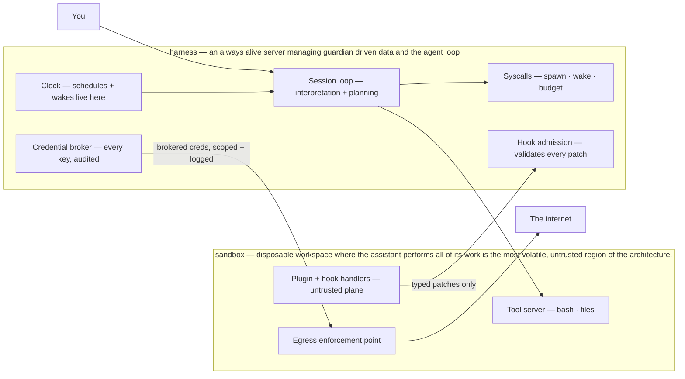

Cadet's north star is a two-machine architecture: one hardened core that thinks, remembers, schedules, and holds every key — and one disposable workbench where your assistant experiments, holding nothing precious.

The worst thing that can happen inside the workbench is losing the workbench.

Follow the story: [Cadet today](/docs/architecture), the [roadmap](/docs/roadmap), and the [Credential Execution Service](/docs/developer-guide/internals/credential-execution-service).

## The harness

The harness is the merged gateway + assistant: the session loop, the clock that fires schedules and wakes, the credential broker, and the admission point that validates every patch a plugin or hook proposes. It is the only thing that can spend a key, fire a timer, or grant a capability — and everything it does is auditable.

The plugin rule carries over unchanged from today: editing code is free, raising capabilities is gated. Plugins keep their powers; they just stop holding keys.

## The sandbox

A disposable execution plane that keeps the parts the assistant physically needs — the tool server for bash and files, the plugin and hook handlers, the egress enforcement point. It holds zero authority: no keys, no clock, no authority over the loop. Untrusted content can do its worst in here and the blast radius is a replaced container.

For how we get there, see the [roadmap](/docs/roadmap).
