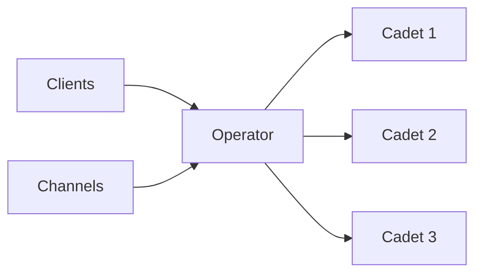
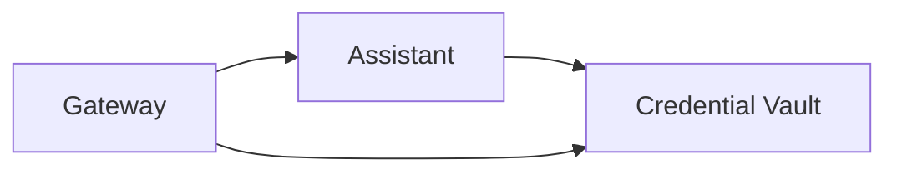

<!-- TODO: Let's actually move this tab to the top of the Key Concepts side nav -->

Cadet is a digital assistant optimized for being hostable anywhere and accessible from anywhere. This page breaks down how it all works from the top down.

## The Cadet Ecosystem

There are three core components in the Cadet Ecosystem:

- Clients & Channels - the avenues by which you can interact with a Cadet
- The Operator - the system that manages multiple Cadets through operations like hatching and retiring. Cadet Cloud is an example of an Operator.
- The Cadet itself - the assistant that can be run anywhere, all the time, serving their guardians.

<!-- TODO: The edges are almost the same color as the background -->
<!-- TODO: Clients & Channels one color, Operator another, the three Cadets a third color, all light colors -->

## How the Cadet Works

The Cadet body is composed of three separate, yet important subsystems:

- Gateway - Manages all incoming requests to the Cadet. It is the boundary that says what can or cannot speak to the Assistant.
- Assistant - The core model loop and workspace. This is where the Assistant spends the majority of its work.
- Credential Vault - Where all the secrets the Cadet needs to authenticate themselves to external systems.

This separation aims to uphold two crucial invariants:

- the Assistant is unable to edit data in the Gateway directly.
- the Assistant is unable to read the secrets stored in the Credential Vault directly.

<!-- TODO: make the Gateway -> Assistant edge bidirectional -->
<!-- TODO: somehow also make an edge from Gate -->
<!-- TODO: make the gateway, assistant, and CES three different light colots -->
<!-- TODO: somehow have an arrow from the "outside world" into Gateway, or find some other way to make it obvious that Gateway is the entry point -->

