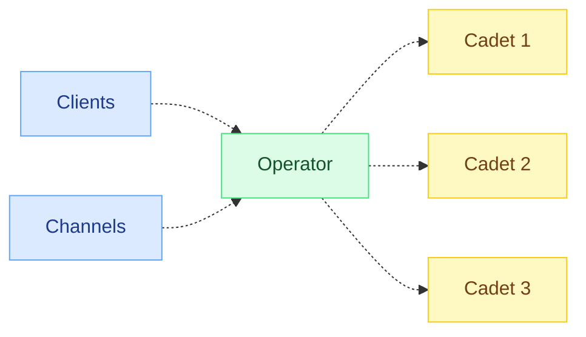
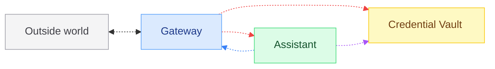
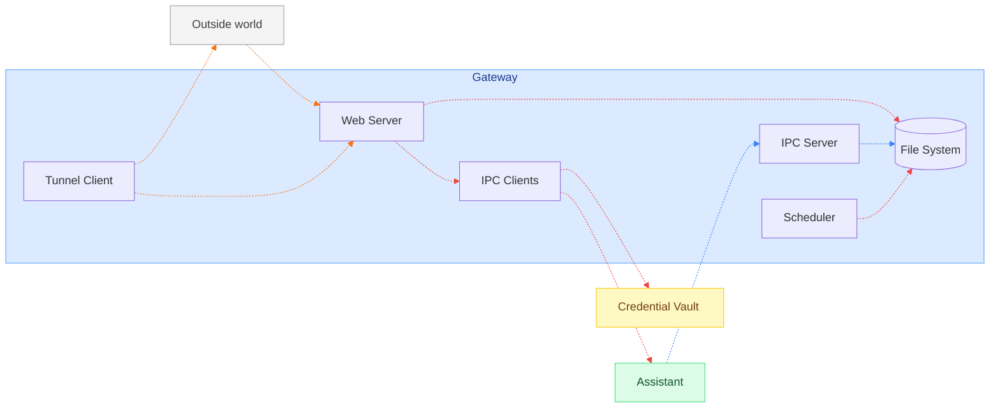

Cadet is a digital assistant optimized for being hostable anywhere and accessible from anywhere. This page breaks down how it all works from the top down.

## The Cadet Ecosystem

There are three core components in the Cadet Ecosystem:

- Clients & Channels - the avenues by which you can interact with a Cadet
- The Operator - the system that manages multiple Cadets through operations like hatching and retiring. Cadet Cloud is an example of an Operator.
- The Cadet itself - the assistant that can be run anywhere, all the time, serving their guardians.

## How the Cadet Works

The Cadet body is composed of three separate, yet important subsystems:

- Gateway - Manages all incoming requests to the Cadet. It is the boundary that says what can or cannot speak to the Assistant.
- Assistant - The core model loop and workspace. This is where the Assistant spends the majority of its work.
- Credential Vault - Where all the secrets the Cadet needs to authenticate themselves to external systems.

This separation aims to uphold two crucial invariants:

- the Assistant is unable to edit data in the Gateway directly.
- the Assistant is unable to read the secrets stored in the Credential Vault directly.

Colors on the arrows carry the access meaning:

- red is read/write — the dangerous direction, worth seeing coming
- blue read-only
- violet read-metadata-only
- orange is just traffic movement: packets flowing, no access either way

## How the Gateway Works

The Gateway is the front door controlling all of the data that comes from the outside world into the Assistant. It is made up of the following components:

- Web Server - The main listener routing both HTTP and WebSocket connections from the outside world
- IPC Server - The main entrypoint where the Assistant can read data from the Gateway.
- File System - The location where the gateway manages all of its data, including logs and its own SQlite database. A default value of `/gateway-security` that can be overridden with `$GATEWAY_SECURITY_DIR`.
- IPC Clients - How it communicates to the Assistant and the Credential Vault
- Tunnel Client - How it connects directly to the outside world, when not receiving its requests from the Operator.
- Scheduler - A process running routine work that keeps the Gateway healthy.

The arrows keep the access convention from the data-plane diagram above:
red edges write (the Gateway reaching the Assistant, the Credential Vault,
and its own file system), blue edges are the Assistant reading back, and
orange edges are just traffic moving through — the world reaching the Web
Server, the Tunnel Client shuttling both ways.

