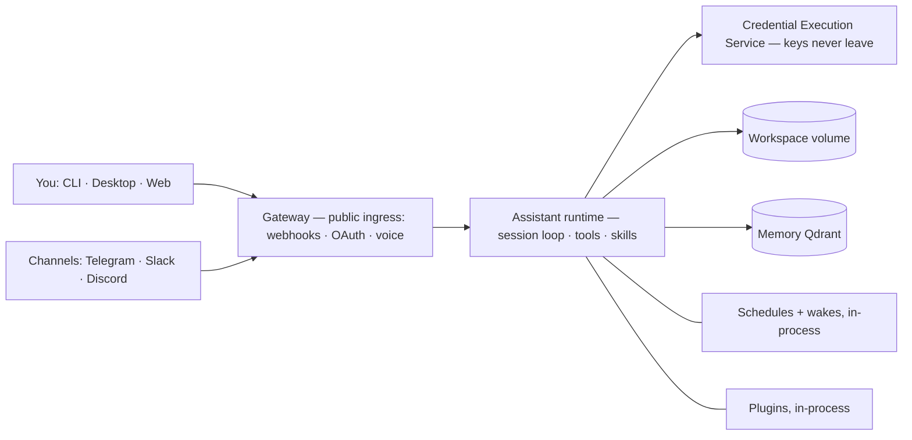

Cadet has three main domains that work together: a runtime that manages conversations and tools, a native client for macOS, and a gateway that handles all external communication.

## The shape of the system

Everything external enters through the gateway; everything credential-bearing goes through CES. The runtime owns the loop, and schedules, wakes, and plugins all live inside it.



## Cloud Domains

### Assistant Runtime

`assistant/`

Bun + TypeScript runtime that owns conversation history, attachment storage, and channel delivery state in a local SQLite database. Exposes a Unix domain socket for the native client, plus an HTTP API consumed by the gateway.

### Native Clients

`clients/`

Native macOS app built with Swift via `CadetAssistantShared`. A menu bar assistant with computer-use (accessibility + CGEvent), chat, and full tool access.

### Gateway

`gateway/`

Standalone Bun + TypeScript service that serves as the public ingress boundary for all external webhooks and callbacks. Owns Telegram integration end-to-end (receives webhooks, routes to assistants, delivers replies). Routes Twilio voice webhooks, handles OAuth callbacks, and optionally acts as an authenticated reverse proxy for the assistant runtime API.

## Repository Structure

```
/
├── .github/              # GitHub Actions workflows
├── assets/               # Brand assets and images
├── assistant/            # Bun-based assistant runtime (runtime, CLI, HTTP API)
├── cli/                  # Cadet CLI
├── clients/              # Native clients (macOS, iOS, Windows, web, docs, Chrome extension)
├── credential-executor/  # Credential Execution Service (isolated RPC boundary)
├── docs/                 # Internal engineering docs and proposals
├── gateway/              # Gateway service (Telegram, Twilio, OAuth, reverse proxy)
├── meta/                 # Meta configuration
├── packages/             # Shared private packages (CES contracts, credential storage, egress proxy)
├── plugins/              # Plugin workspace (MCP catalog, marketplace)
├── scripts/              # Utility scripts (publishing, tunneling, releases)
└── skills/               # Bundled skill definitions
```

## Architecture Docs

Detailed architecture docs are split by ownership domain, close to the code:

| Document                                                                                     | What's Covered                                                           |
| -------------------------------------------------------------------------------------------- | ------------------------------------------------------------------------ |
| [Architecture](/docs/developer-guide/internals/architecture)                                 | Cross-system index — invariants, domain boundaries, data flow            |
| [Assistant Architecture](/docs/developer-guide/internals/assistant-architecture)             | Runtime internals — conversation loop, tool dispatch, memory, scheduling |
| [Gateway Architecture](/docs/developer-guide/internals/gateway-architecture)                 | Ingress boundary — webhooks, Telegram, Twilio, reverse proxy             |
| [Security Architecture](/docs/developer-guide/internals/security)                            | Security model — sandbox, credentials, permissions, secret handling      |
| [Memory Architecture](/docs/developer-guide/internals/memory)                                | Memory system — extraction, recall, provenance gates                     |
| [Scheduling Architecture](/docs/developer-guide/internals/scheduling)                        | Heartbeats, wake intents, and task queues                                |
| [Integrations Architecture](/docs/developer-guide/internals/integrations)                    | How OAuth2 skills, channels, and plugins attach to the assistant         |
| [Turn Actor Architecture](/docs/developer-guide/internals/turn-actor)                        | How a conversation turn is routed and executed                           |
| [Credential Execution Service](/docs/developer-guide/internals/credential-execution-service) | CES — credential isolation, secure commands, RPC boundary                |
